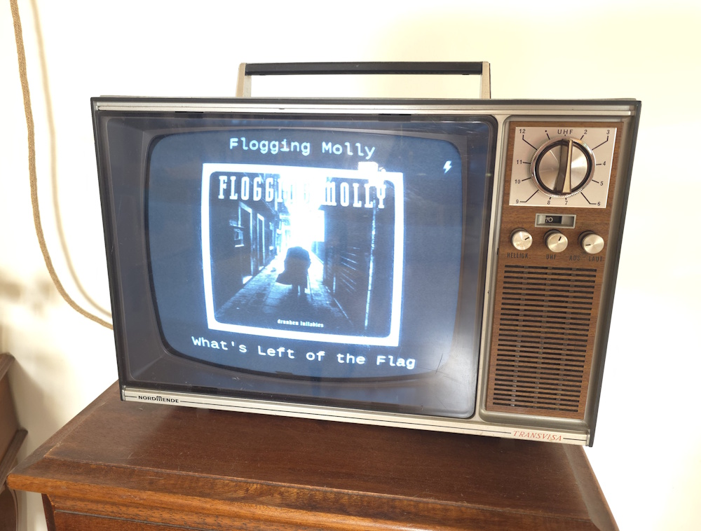

# SpotifyCoverFlow for Retro-TV

Display a full-screen image of your current playing song on Spotify.
The intended use is to dedicate a RaspberryPi (or similar device) and a monitor/screen to be an always on display.

Changes:
* have just spotify's "low" 640px resolution images
* convert to HSV based grayscale and enchance contrast for better display on old black and white retro tube tv

Based on kylesurowiec'a [spotify-coverflow](https://github.com/kylesurowiec/spotify-coverflow) (that also collects higher resolution images from itunes)
Keys and callback URI are given with your personal Spotify developer account, register here: [Spotify Developer](https://developer.spotify.com/my-applications/#!/).

Looks like this:

